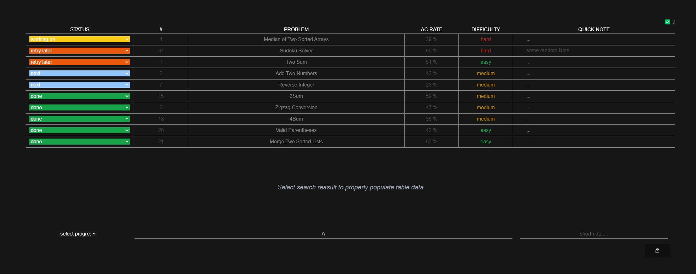

Purpose:
The project was created to help others including myself learn 
datastructures and algorithms. 

<h1>Features</h1>
  
the features will be discribed in the following order

  
  <h3>Home page</h3>
  <h3>Learning page</h3>
  <h3>Practice Page</h3>
  <h4>customization Page (going to add this when I have the time)</h4>
  <h3>questions box</h3>

<h2>Home Page</h2>
  
The home page is just a greeting as well as two options create acount/sign in or use demo (only save your data in local storage) this is mostly just for recruters

<h2>Learning Page</h2>
  
The Learning page is where you can begin to learn about data structures and algorithms. There will be multiple subjects that you can select to learn about.

  
the layout is simple it will have a short description, diagram, more in depth description, some video recommandations, and lastly my sources

<h2>Practice Page</h2>
  
The practice Page is practicaly a large table that is connected to the leetcode GraphQl api where you can and your completion/progress.

  
This is just mostly to keep track of the work that you have done

<h2>Customization Page</h2>
  
the plan for this is to connect be able to change the color pallet and slight styling of the application but im not sure when i'll have time to add this as I have another project i want to get done before I come back to this

<h2>questions box</h2>
  
The Questions box will populate diffrently depending on what page that you are on.

  
These questions are some that I thought people might have, as well as others that have been asked of me.

    
if you have anything you would like to ask please feel free to reach out in the issues or through my linkedIn

Tech Stack:
<ul>
  <li>HTML, CSS, JS</li>
  <li>React.js</li>
  <li>Vite</li>
  <li>Express.js</li>
  <li>Cors</li>
  <li>tailwind.css</li>
  <li>Node.js</li>
  <li>Postcss</li>
  <li>GraphQl</li>
  <li>JSON</li>
</ul>

