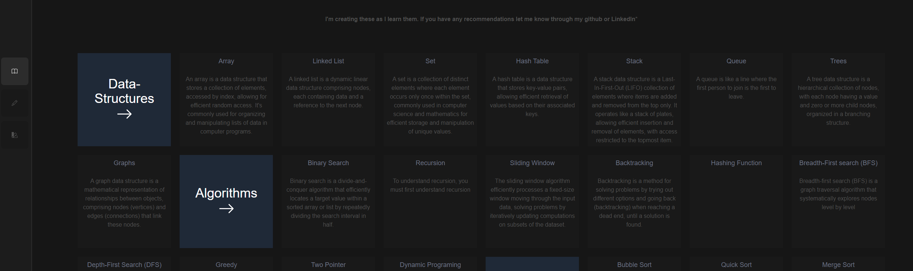

 
<h1 style="color:white">Learning Hub</h1>

 <!-- view live site link -->
 <a href="https://ls2355.github.io/Learning-Hub/"></a> 
  <!-- styleing is in the src url= https://custom-icon-badges.demolab.com/badge/ <text>-<color> ?style=<style> &logo=<logo>   -->

<!-- for more info got to https://github.com/DenverCoder1/custom-icon-badges -->


<h2 style="color:#e3de40"> Purpose: </h2>
<h4> The purpose of this project is to help others including myself learn/study
datastructures and algorithms.</h4>

<h2 style="color:#04857a"> Features </h2>
  <h4>List of Features in order</h4>
  <ul>
    <li>Learning Page</li>
    <li>Practice Page</li>
    <li>Customization Page(not done)</li>
    <li>questions Box</li>
  </ul>

#### 🗒️ NOTE <br />

<p> - Why no create/login account option?  simply put I dont want the responsibility of holding someones data for a site that i'm not going to be constantly monitoring. If enough people would like that option, I might add it but for now all user data is saved in your local storage (so don't clear it)</p>

#### ⚠️Important Information⚠️
  <p style=" background:#780A1a ; padding: 5px 3px; width:80%; border-radius:5px;">all data is user inputed data is stored in your local storage. so DON'T CLEAR IT <br />
Practice section will does work but i am not hosting the server anywhere so it will not be able to fetch data from leetcode</p>

---
<h3>Learning Page/h3>
  
  <p>The Learning page is where you can begin to learn about data structures and algorithms. There will be multiple subjects that you can select to learn about.</p>
  <p>the layout is simple it will have a short description, diagram, more in depth description, some video recommandations, and lastly my sources</p>

---
<h3>Practice Page</h3>
  " src="./README_images/Practice-img.png">
  <p>The practice Page is practicaly a large table that is connected to the leetcode GraphQl api where you can and your completion/progress.</p>
  <p>This is just mostly to keep track of the work that you have done</p>

---
<h3>Customization Page</h3>
  <p>the plan for this is to connect be able to change the color pallet and slight styling of the application but im not sure when i'll have time to add this as I have another project i want to get done before I come back to this</p>

---
<h3>Questions box</h3>
  " src="./">
  <p>The Questions box will populate diffrently depending on what page that you are on.</p>
  <p>These questions are some that I thought people might have, as well as others that have been asked of me.</p>
  <p>if you have anything you would like to ask please feel free to reach out in the issues or through my linkedIn</p>

---

<h2>Installation and Running 🌐</h2>
  <ol>
  <li>download Zip or clone Repo</li>

``` 
  git clone <repo>
```

  <li>cd into the server folder, install dependancies, run server</li>

``` 
  cd ./server
  npm i
  npm start  
```  
<li>then just run index.html</li>
<li>if you want to run dev</li>

``` git
  cd ../
  cd ./client
  npm i
  npm run preview
```
  </ol>


## Tech Stack:
<!-- to cange color to hex value put %23<value> after color -->


 
 
 
 
 
 

 
 


<details><summary>Notes to self (just ignore this)</summary>

should i just cut out the customization section completely??


</details>
